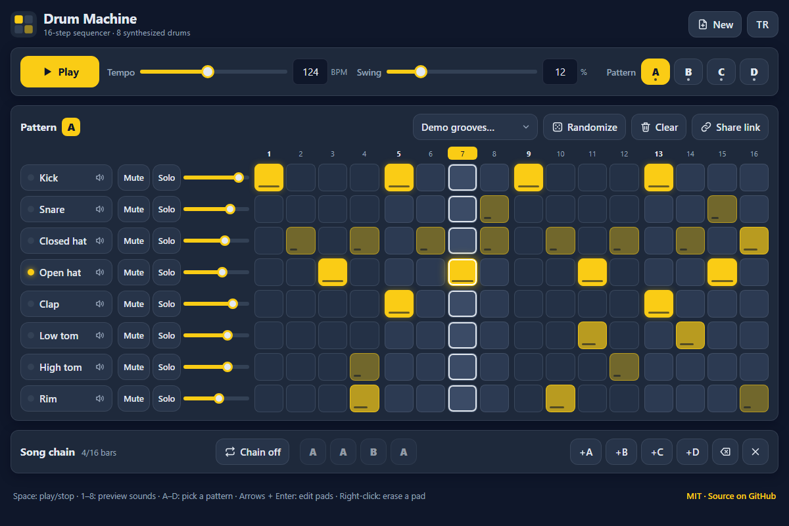

# Drum Machine - a 16-step, 8-track drum machine that runs in your browser

[](#tests) [](LICENSE)

**▶ Open the app: https://celaldrg.github.io/drum-machine/**



Every drum is synthesized live with the Web Audio API - no samples, no build step, no dependencies. Plain HTML, CSS and JavaScript modules.

## Features

- 8 tracks x 16 steps: kick, snare, closed hat, open hat, clap, low tom, high tom and rim.
- Three velocity levels per step (soft, normal, accent): tap a pad to cycle through them.
- Synthesized voices: oscillators, noise, filters and envelopes; the open hat is choked by the closed hat.
- Tempo 60-200 BPM and swing 0-60 %, each with a slider and a number field.
- Four patterns (A-D) and a song chain of up to 16 bars that plays bar by bar.
- Per track: a preview pad, mute, solo and volume.
- Randomize writes a fresh groove with a musical density per track; four demo grooves (rock, house, hip-hop, bossa-style).
- Clear, Randomize, demo grooves, New and clearing the chain can be undone from the message that pops up.
- Share link: the whole song fits in the URL and is copied to the clipboard. Opening a link leaves your saved song alone until you edit, and Undo takes you back to it.
- Steady timing: a lookahead scheduler books every step a little ahead on the audio clock.
- Your song is saved in the browser; the interface speaks English and Turkish.
- Works on phones (two pages of 8 steps that follow the playhead) and fully from the keyboard.

## How to use

**Touch and mouse**

- Tap a pad to cycle it: off → normal → accent → soft → off. Right-click, or a long press on a touch screen, erases a pad.
- Play/Stop, tempo, swing and the pattern buttons A-D are at the top.
- Tap a track name (the button with the speaker) to hear its sound. Mute, Solo and the slider next to it set how the track is heard.
- On phones, the 1-8 and 9-16 buttons switch between the two halves of the bar. While playing, the page follows the playhead; after you touch the grid it stays put for a few seconds.
- Song chain: +A to +D add bars, tapping a bar changes its pattern (A → B → C → D), ⌫ removes the last bar and ✕ clears the chain. "Chain on" plays the chain; "Chain off" loops the selected pattern.
- Share link copies a link to the whole song; if the clipboard is blocked, the link is in the address bar. Demo grooves, Randomize and Clear act on the selected pattern.

**Keyboard**

| Key | Action |
| --- | --- |
| Space | Play / stop |
| 1-8 | Hear the sound of track 1-8 |
| A-D | Select pattern A-D |
| Tab, then the arrow keys | Move between pads |
| Enter | Cycle the focused pad |
| Delete or Backspace | Erase the focused pad, or remove the focused chain bar |

Browsers only allow sound after a click, tap or key press, so the audio starts with your first one.

## Run locally

Any static web server works. ES modules need `http://`, they do not load from `file://`.

```sh
npx serve .
```

Then open the address it prints.

## Tests

```sh
node --test
```

Node.js 22 or newer, no dependencies. The tests cover:

- step times at 120 BPM with and without swing;
- the lookahead scheduler over 10,000 simulated timer calls with jittery, stalled and tempo-changing clocks: no step is booked twice and none is missed;
- mute, solo, volume and velocity gains;
- share-link and JSON round trips for 500 seeded random songs, and rejection of broken input;
- the song chain order, the machine model (editing, playback, the ?demo state), the drum voices and the demo grooves;
- the UI helpers that need no browser: translations (both languages complete, every key used by the page exists), keyboard shortcuts, the storage fallbacks and the start-up choice;
- autosave (a song opened from a link is saved only after an edit), phone pages that follow the playhead, long-press detection and the clipboard timeout.

## Project structure

```text
index.html            page markup
style.css             dark theme, mobile-first layout
src/
  constants.js        tracks, steps and limits
  rng.js              seeded random numbers
  pattern.js          one pattern: 8 x 16 velocities
  song.js             tempo, swing, patterns A-D, chain, mixer
  mixer.js            mute, solo and gains
  scheduler.js        step times, swing, lookahead windows
  machine.js          the drum machine model: editing and playback
  codec.js            share links and JSON
  voices.js           synthesized drum voices as data
  demos.js            demo grooves and the ?demo state
  i18n.js             English and Turkish strings
  storage.js          safe localStorage helper
  autosave.js         debounced saving of the song
  session.js          where the starting song comes from
  keymap.js           keyboard shortcuts
  long-press.js       long-press detection for touch screens
  paging.js           phone pages that follow the playhead
  clipboard.js        clipboard copy with a timeout
  audio.js            Web Audio engine
  player.js           playback loop
  grid-view.js, chain-view.js, transport-view.js, toast.js, dom.js   UI parts
  app.js, main.js     wiring and start-up
test/                 node:test suites
docs/screenshot.png   README screenshot
```

## License

MIT - see [LICENSE](LICENSE).

## Türkçe

Tarayıcıda çalışan 16 adımlı, 8 kanallı bir davul makinesi. Bütün davullar Web Audio API ile anında sentezlenir: ses dosyası, derleme adımı ve bağımlılık yok. Düz HTML, CSS ve JavaScript modülleri.

**▶ Uygulamayı aç: https://celaldrg.github.io/drum-machine/**

### Özellikler

- 8 kanal x 16 adım: bas davul, trampet, kapalı hat, açık hat, alkış, pes tom, tiz tom ve kenar.
- Her adımda üç vuruş gücü (hafif, normal, vurgulu): pede dokundukça sırayla değişir.
- Sentez sesler: osilatörler, gürültü, filtreler ve zarflar; kapalı hat açık hattı keser.
- 60-200 BPM tempo ve %0-60 swing; ikisinde de kaydırıcı ve sayı kutusu var.
- Dört desen (A-D) ve en fazla 16 ölçülük, ölçü ölçü çalan bir şarkı zinciri.
- Her kanalda dinleme pedi, sessiz, solo ve ses düzeyi.
- Rastgele düğmesi kanal başına müzikal yoğunlukta yeni bir ritim yazar; dört demo ritim var (rock, house, hip-hop, bossa tarzı).
- Temizle, Rastgele, demo ritimler, Yeni ve zinciri temizleme, açılan mesajdaki "Geri al" ile geri alınır.
- Paylaşım bağlantısı: şarkının tamamı adrese sığar ve panoya kopyalanır. Bir bağlantı açınca kayıtlı şarkın sen düzenleyene kadar korunur; "Geri al" seni ona döndürür.
- Kararlı zamanlama: ileriye bakan zamanlayıcı her adımı ses saatinde biraz önceden ayırtır.
- Şarkın tarayıcıda saklanır; arayüz İngilizce ve Türkçe.
- Telefonda (çalma imlecini izleyen, 8 adımlık iki sayfa) ve tamamen klavyeyle kullanılır.

### Nasıl kullanılır

**Dokunma ve fare**

- Pede dokununca sırayla değişir: kapalı → normal → vurgulu → hafif → kapalı. Sağ tık ya da dokunmatik ekranda uzun basış pedi siler.
- Çal/Durdur, tempo, swing ve A-D desen düğmeleri üstte.
- Kanal adına (hoparlör simgeli düğme) dokununca sesini duyarsın. Yanındaki Sessiz, Solo ve kaydırıcı kanalın nasıl duyulacağını ayarlar.
- Telefonda 1-8 ve 9-16 düğmeleri ölçünün iki yarısı arasında geçiş yapar. Çalarken sayfa çalma imlecini izler; ızgaraya dokununca birkaç saniye yerinde kalır.
- Şarkı zinciri: +A ... +D ölçü ekler, bir ölçüye dokunmak desenini değiştirir (A → B → C → D), ⌫ son ölçüyü siler, ✕ zinciri temizler. "Zincir açık" zinciri çalar; "Zincir kapalı" seçili deseni döngüde çalar.
- Paylaş düğmesi şarkının tamamını içeren bağlantıyı kopyalar; pano engelliyse bağlantı adres çubuğundadır. Demo ritimler, Rastgele ve Temizle seçili desene uygulanır.

**Klavye**

| Tuş | İşlev |
| --- | --- |
| Boşluk | Çal / durdur |
| 1-8 | 1-8. kanalın sesini dinle |
| A-D | A-D desenini seç |
| Tab, sonra ok tuşları | Pedler arasında gezin |
| Enter | Seçili pedi değiştir |
| Delete veya Backspace | Seçili pedi sil ya da seçili zincir ölçüsünü kaldır |

Tarayıcılar sese ancak bir tıklama, dokunma ya da tuş basışından sonra izin verir; ses ilk etkileşiminle başlar.

### Yerelde çalıştırma

Herhangi bir statik web sunucusu yeterli. ES modülleri `file://` ile değil, `http://` ile yüklenir.

```sh
npx serve .
```

Sonra yazdığı adresi aç.

### Testler

```sh
node --test
```

Node.js 22 veya üstü, bağımlılık yok. Testler şunları kapsar:

- 120 BPM'de swing'li ve swing'siz adım zamanları;
- titreşimli, takılan ve tempo değiştiren saatlerle 10.000 zamanlayıcı çağrısında ileriye bakan zamanlayıcı: hiçbir adım iki kez ayırtılmaz, hiçbiri atlanmaz;
- sessiz, solo, ses düzeyi ve vuruş gücü kazançları;
- 500 tohumlu rastgele şarkı için paylaşım bağlantısı ve JSON gidiş-dönüşü, bozuk girdinin reddi;
- zincir sırası, makine modeli (düzenleme, çalma, ?demo durumu), davul sesleri ve demo ritimler;
- tarayıcı gerektirmeyen arayüz yardımcıları: çeviriler (iki dil eksiksiz, sayfanın kullandığı her anahtar var), klavye kısayolları, depolama yedekleri ve açılışta şarkı seçimi;
- otomatik kayıt (bağlantıdan açılan şarkı ancak düzenlenince kaydedilir), telefonda çalma imlecini izleyen sayfalar, uzun basış algılama ve pano zaman aşımı.

### Lisans

MIT - bkz. [LICENSE](LICENSE).
